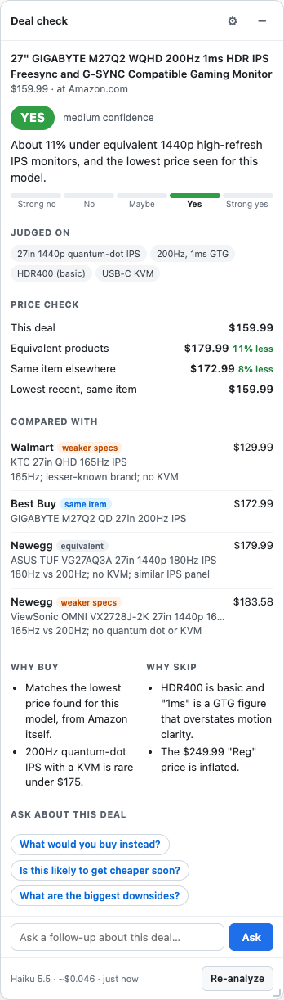

# Deals Analyzer

A browser extension that tells you whether a deal is actually worth it, on [eDealinfo.com](https://www.edealinfo.com) or on any store's product page. It has Claude Haiku 5.5 work out which specs set the product's value, then search the web for what products with *equivalent specs and build quality* sell for right now, not just other listings of the same item. It treats the listing's claims skeptically, then rates the deal:

**Strong no · No · Maybe · Yes · Strong yes**



The verdict appears in a panel on the right side of the page with:

- the specs it judged the product on (CPU generation, RAM, panel type, and so on)
- the price compared with equivalent products (the main benchmark) and with the same item elsewhere
- comparable offers tagged **same item**, **equivalent**, **better specs** or **weaker specs**, with how each one's specs differ. Each links to that store's own product page, and its price is checked against that page (see [Price checks](#price-checks))
- ways to pay less that a search result states: coupon codes, student, military and member pricing
- reasons to buy and to skip, including caveats about the product itself (reviews, model age, inflated spec-sheet claims, seller and warranty)
- the searches Claude ran and the sources it saw
- the model used and what the analysis cost

Below the verdict you can **ask follow-up questions**, such as "What would you buy instead?" or "I have EPP pricing, does that change it?". Claude answers in the panel with sources, searching again when it needs to. If your answer changes its assessment, the rating updates and is marked "updated after your question". The chat is saved with the deal for 24 hours.

**On eDealinfo** it runs as soon as you open a deal, both on deal pages (`/d/...`) and in the deal pop-ups on listing pages. Pop-ups also get an **"Is this a good deal? Analyze"** button for reopening the panel.

**On any other site**, the same happens automatically: open a product page and the panel opens and checks it, reading the product, price, seller and condition from the page. **This spends money as you browse, about $0.05 per new product.** To limit that, it waits 1.2 seconds in case you bounce straight back, a tab opened in the background waits until you view it, a page with no price isn't analyzed, and a deal analyzed in the last 24 hours is shown for free. Turn off **Analyze automatically** and product pages get a small **Deal check** tab instead, which analyzes when clicked. The toolbar button (or **Alt+Shift+D**) analyzes any page directly, including ones it doesn't recognize.

A page counts as a product page when it declares one (schema.org product data, product meta tags, or Amazon's product layout), is laid out like one (the product's heading, a price after it, and one to three "Add to cart" or "Buy now" buttons), or is a single post on a known deal site (Slickdeals, DealNews, Ben's Bargains and others). Articles have no price or button, and search pages have one per product, so they aren't checked. It follows stores that change products without reloading (Walmart, Best Buy, Target) and prices that appear after the page loads. Checked in Firefox on Amazon, Walmart, Best Buy, Target, Costco, Home Depot, Dick's, Staples, Kohl's, B&H, eBay and Woot.

- **Amazon** has its own reader, because Amazon publishes no product data for other tools and its details matter for the verdict: who sells and ships it, the "List Price" or "Typical price" it compares against, coupons, Renewed condition, and the spec table.
- **Every other store** uses the product data stores publish for search engines (schema.org JSON-LD and microdata, product meta tags), with the page itself as a fallback. Claude also gets a short excerpt of the product section's text, so details the markup leaves out still count: Woot's "Reference Price", a 90-day warranty, a shipping charge.

**Moving it around:** drag the header to move the panel, and drag its left, right or bottom edge (or a bottom corner) to resize it. Double-click the header to put it back. Minimize it and it shrinks to a tab showing the rating, which you can also drag anywhere. Position and size are remembered.

<br clear="right">

## Install (unpacked)

You need an Anthropic API key from [console.anthropic.com](https://console.anthropic.com/settings/keys).

Download `deals-analyzer-<version>.zip` from the latest release on the repo's **Releases** page. Every push to `main` that passes CI publishes a new one. To run straight from a clone instead, use the **`extension/`** folder (not the repo root) wherever the steps below say "the unzipped folder" or "the zip".

**Chrome / Edge / Brave**
1. Unzip the download.
2. Go to `chrome://extensions` and turn on **Developer mode**.
3. Click **Load unpacked** and pick the unzipped folder.
4. The settings page opens. Paste your API key, click **Test key** (free), then **Save**.

**Firefox** (142 or later)
1. Go to `about:debugging#/runtime/this-firefox`.
2. Click **Load Temporary Add-on…** and pick the zip itself, or `manifest.json` inside the folder.
3. Open the extension's settings: go to `about:addons`, click **Deals Analyzer**, then **Preferences**. Paste your key and save. Click **Grant access** if the page shows it: Firefox asks before an extension can read websites, and automatic checks and price checks need that. (Without it, the toolbar button still works on any page you click it on, but compared prices stay "not confirmed".)

Temporary add-ons in Firefox are removed when Firefox restarts. From a clone, `npm run start:firefox` opens a separate Firefox window with the extension installed and a profile that remembers your key.

**Updating in Chrome without re-entering your key:** unzip the new release into the *same* folder, replacing the files, then click the reload button on the extension's card in `chrome://extensions`. Chrome identifies an unpacked extension by its folder, so loading from a different folder gives you a fresh copy with empty settings.

Then open any eDealinfo deal or store product page. Pinning the toolbar button keeps it one click away too.

## Settings

Click ⚙ in the panel, or right-click the toolbar button and choose **Options**. (Clicking the button itself analyzes the page; on pages it can't read, such as the browser's own pages, it opens the settings.)

| Setting | Default | Notes |
|---|---|---|
| API key | — | Stored in `chrome.storage.local` in this browser only; sent only to `api.anthropic.com`. |
| Model | Claude Haiku 5.5 | Sonnet 5.5 is more thorough at roughly 20× the cost. |
| Effort | Medium | Low is cheaper and faster but may search less. |
| Web searches per deal | 6 | Upper limit; Claude usually uses 3–5. $0.01 each. |
| Analyze automatically | On | Product pages on every site, plus eDealinfo deal pages and pop-ups, are analyzed when you open them, at about $0.05 per new product. When off, you click to analyze. |
| Panel on store pages | On | Off keeps the extension off store pages, automatic checks included, except eDealinfo. The toolbar button still works. |
| Background tab for blocked stores | On | Opens stores that refuse the background price check in a muted tab for a few seconds. Off, those prices are marked "not confirmed". |

Verdicts are cached for 24 hours per deal, so revisiting a deal is free. **Re-analyze** forces a fresh one.

## Cost

With Haiku 5.5 a typical analysis costs **about $0.05**, mostly for web searches ($0.01 each); tokens cost $0.10 per million in and $0.50 per million out. An analysis that searches in two rounds can pass 100K input tokens, where Haiku's price steps up: one live run with 6 searches cost $0.13. With **Analyze automatically** on, every new product you open is charged, so browsing 20 products costs about $1. The panel footer shows an estimate for every analysis. Reading store pages is free; re-rating after a price disagreement adds a fraction of a cent.

Follow-up questions cost about $0.002 plus $0.01 per search Claude runs, typically $0.002–$0.02; Claude answers from what it already found and searches only for facts it doesn't have. They send Claude its verdict and the chat rather than the original search results, which run to ~100K tokens and would make each question cost as much as a new analysis.

## Speed

An analysis takes about **17–21 seconds** in live runs. The searches appear in the panel within 3 seconds, the rating at about 13–16 seconds, and the offers and reasons fill in after it. Then come the price checks: usually a couple of seconds, up to about 8 more when a store needs a background tab, and a few more if Claude re-rates. Follow-up questions take about 3–7 seconds, a few more when Claude needs to search.

Where the time goes, measured with `npm run analyze`:

| Step | Time |
|---|---|
| Searching: Claude issues all its searches at once and they run in parallel | ~2–3 s (occasionally 10 s+ when a search provider is slow) |
| Thinking it over | ~4–9 s |
| Writing the verdict | ~4–6 s |
| Checking store pages | ~2–8 s |

Searching was never the slow part. Haiku writes about 300 tokens a second, so what costs time is what Claude writes. The verdict is built to be short:

- **Compact verdict.** Short field names and word limits on every line. Claude does write each offer's URL, because matching offers to search results by name left most of them without a link; `resolveOffers` in `claude.js` accepts only URLs from results it actually saw.
- **Rating early.** The verdict lists the prices first, then the rating, then the offers and reasons. The response streams, so the panel shows each part as it arrives.
- **One round of searches.** The prompt asks Claude to plan its searches and send them together; each extra round costs a search wait plus more thinking.
- **Thinking stays on.** Turning it off cut the time to ~7 seconds, but the ratings stopped being reliable: in testing, a $680 TV was rated against $1,400 rivals as if it cost more than them. Thinking is the cost of a correct rating.

Two levers that don't help: lower effort didn't shorten Haiku's thinking, and the dynamic-filtering search tool (`web_search_20260209`) is accepted for Haiku but its searches fail.

## Price checks

Search results can be months old, so a price Claude saw there may be wrong by the time you read it. After the verdict, your browser reads each compared store's page:

| The panel shows | Meaning |
|---|---|
| **✓ checked** | The store's page shows this price right now. |
| ~~$248.00~~ **$198.00**, *store page* | The page disagrees with the search result; this is the page's price. If the difference is 5% or more, Claude reconsiders its rating, and the panel says so if the rating changes. |
| **not confirmed** | The store didn't let the extension read its page, or the price couldn't be read reliably. The price comes from a search result, so open the link to check. |

Offers are left out, and counted in a note, when their page is gone, sold out or about a different product, or when there's no store product page to link to. In live testing this replaced a stale $279.95 eBay price with the real $219.95 and a $248 Best Buy price with $198, and removed Newegg and CompSource listings that were out of stock.

**How protected stores are handled.** A plain background request reads most stores, including Best Buy, Walmart, B&H and Cloudflare-protected shops, when it comes from a real browser. Stores that refuse it (eBay, for one) usually load normally as a page, so up to 3 of them per analysis open in a muted background tab that closes itself after a few seconds. Those are normal visits, so they use your session and may appear in that site's recently viewed items. The background request sends no cookies. Nothing disguises the request or solves a challenge; a store that refuses both stays "not confirmed". Some stores need a sign-in to show a price at all (CDW), so theirs stays unconfirmed too.

Coupon codes and who qualifies for student or member pricing can't be checked this way, so **Ways to pay less** only lists what a search result states, links to that result, and says it isn't verified. Ratings are based on the price anyone can get.

## How it works

```
deal or product page ──► content scripts ──(port)──► background service worker ──► Claude Messages API
                         extract.js: eDealinfo deals       claude.js: Haiku 5.5 + web_search, streamed
                         extract-page.js: store pages      verdict.js: compact strict submit_verdict tool
                         panel.js:   side panel            pricecheck.js: reads offers' store pages
                         main.js:    wiring                cache.js: 24h verdict cache
```

- **`extension/src/content/extract.js`**: reads an eDealinfo deal: title, product, store and seller, condition (new, open box, refurbished, used), final price, the "Reg" price, coupon code, shipping, UPC, model number, ASIN, eDealinfo's price-comparison prices, and its price history for the item.
- **`extension/src/content/extract-page.js`**: reads a store's product page. Amazon has an adapter; every other site goes through schema.org JSON-LD, then microdata, then product meta tags, then the page itself (the heading that matches the product name, the first price after it that isn't struck out). It keeps up to 2,500 characters of the product section's text, starting at the product name (so not the site header), with delivery locations and greetings scrubbed out (`scrubPersonal`).
- **`extension/src/background/claude.js`**: streams `POST /v1/messages` with the `web_search` tool and a strict `submit_verdict` tool. As events arrive it reports each search, what Claude is doing, and each verdict field. It resumes `pause_turn` responses, retries 429/5xx errors and dropped streams, and handles refusals.
- **`extension/src/background/prompt.js`**: the instructions and rating rubric. Claude first pins down the specs that set the product's value, spends one search on the exact item and most of the rest on competing models with matching specs and build quality, and questions the listing (inflated "Reg" prices, spec-sheet marketing, reviews, seller). The rating is measured against the cheapest reliable way to get equivalent value. The rubric is kept word for word (a test checks it); shortening it changed ratings in testing.
- **`askFollowUp()`** in `claude.js` answers follow-up questions, starting from the stored verdict (sent as compact text) and chat (`buildFollowUpMessages()` in `prompt.js`). If Claude revises the verdict without explaining, it's given another turn to write the answer.
- **`resolveOffers()`** in `claude.js` settles the compared offers: a link must be a search result Claude saw, on that store's own domain, and a product page rather than a search page, deal post or price tracker. It also removes the deal itself: the same page or ASIN, or the same item at the store selling it, including the store behind a deal-site post (Claude names it in the verdict's `seller`). Another seller's eBay listing of the same item stays.
- **`extension/src/background/pricecheck.js`** reads those pages, in parallel, with regular expressions (service workers have no DOM): schema.org data, meta tags, microdata, and readers for Amazon and Newegg, whose pages list other products' prices too. It prefers no answer to a doubtful one. A rendered-page guess can confirm a quoted price but never replace it, and a price more than 3× off is ignored. Only the numbers reach Claude, never page text. When they disagree, `checkPrices()` in `claude.js` asks Claude to re-rate from the compact verdict rather than the ~100K tokens of search results.
- **`main.js`** runs on every page. On eDealinfo it handles deals and pop-ups; elsewhere it checks (locally, in `extract-page.js`'s strict mode) whether the page is a product page, re-checking as single-page stores navigate and as late prices render, then analyzes it, or with auto-analyze off shows the Deal check tab. It stays inert in the tabs `pricecheck.js` opens, which the service worker identifies, so reading a price can't start another paid analysis.
- **The toolbar button** (`service-worker.js`) uses `activeTab` and `scripting`: it injects the content scripts where the browser hasn't (Firefox before you grant site access) and calls `analyzePage()`.
- The panel lives in a shadow DOM and inserts model output only as text. Answers support paragraphs, `- ` lists and **bold**, each built as DOM nodes.

The extension calls the API with plain `fetch` rather than the Anthropic SDK, so it loads unpacked with no build step.

## Privacy

When a deal is analyzed, its details (title, price, store, model number, the page URL) are sent to Anthropic's API, which runs the web searches. On a store page this includes the specs and ratings the page lists and up to 2,500 characters of text from the product's section of the page. That text starts at the product name, so the site's header (where stores show your name) is left out, and delivery locations and greetings in it ("Delivering to Anytown 12345", "Pickup at Main St", "Hello, Sam") are replaced before anything is sent. The Amazon reader sends only the feature bullets, not page text. The extension reads pages on your computer to decide whether they're product pages. **With Analyze automatically on (the default), viewing a product page sends these details to Anthropic with no click.** Turn it off and nothing leaves the browser until you click the tab or the toolbar button. To check compared prices, your browser loads those stores' pages directly, so those stores see the visit; only the prices go to Anthropic. Nothing else from your browsing is sent. Your API key never reaches the page; only the background worker uses it.

## Development

```sh
npm install
npm test               # unit tests: extractor on saved eDealinfo pages, API loop with a mocked fetch, panel in jsdom
npm run test:e2e       # loads the extension in Chromium against saved pages and a stubbed API (run `npx playwright install chromium` once)
npm run lint           # ESLint + Mozilla's web-ext lint
npm run canary         # checks that today's live eDealinfo deals still parse
npm run package        # builds dist/*.zip from extension/
```

**Prompt work.** `npm run analyze -- <deal or product page URL, or saved .html> ["follow-up question"]` runs one analysis, plus an optional follow-up, from the command line. It prints a timeline (each search, each stage, when the rating arrived) and then the full verdict as JSON, which makes before/after comparisons of prompts and timing easy. For a saved store page, set `PAGE_URL` to the address it came from, since the Amazon reader is picked by site. It uses the key in `.env` and costs a few cents per run.

**Store access.** Test it in a real browser. Automated Chromium (Playwright) gets blocked by stores that serve a normal Firefox fine, including Best Buy, Walmart and B&H, so its failures say little about what shoppers see. `web-ext run` starts an unautomated Firefox. Node's `fetch` in `npm run analyze` is blocked by many stores too, so offers there often show `unverified` where a browser would confirm them, and it doesn't use tabs.

**Live test.** `npm run test:live` loads the extension, enters the key from a local `.env` on the settings page, opens a real eDealinfo deal, and waits for a real verdict. It costs a few cents per run.

```sh
cp .env.example .env   # then set ANTHROPIC_API_KEY=...
npm run test:live
```

`.env` is git-ignored and sits outside `extension/`, so it is never packaged or loaded by the browser. Keep it that way.

**Test fixtures.** `test/fixtures/` holds real pages with scripts, ads and site headers removed. `detail-*` and `popup-*` are eDealinfo pages: an Amazon deal, an open-box eBay deal with a coupon, a refurbished deal without a UPC, a pop-up, and a promo pop-up that has no price. If the canary fails, save a fresh page there, update `extract.js`, and extend `test/extract.test.js`. `store-*` are store product pages (an Amazon monitor and a Woot headset) for `extract-page.js` and `test/extract-page.test.js`. If a store's page reads wrong, save it (removing the header, which can show your address), add it there, and either fix the generic reader or add a small adapter.

### CI

- **`.github/workflows/ci.yml`** (every push and PR): lint, unit tests, the Chromium end-to-end tests, then a packaged zip uploaded as a build artifact. It needs no secrets. On pushes to `main` that pass, it also publishes a GitHub release `v1.0.<run number>` with the zip attached (the build number is stamped into the manifest by `scripts/set-build-version.mjs`).
- **`.github/workflows/site-canary.yml`** (weekly, or run by hand): checks live eDealinfo pages still parse.
